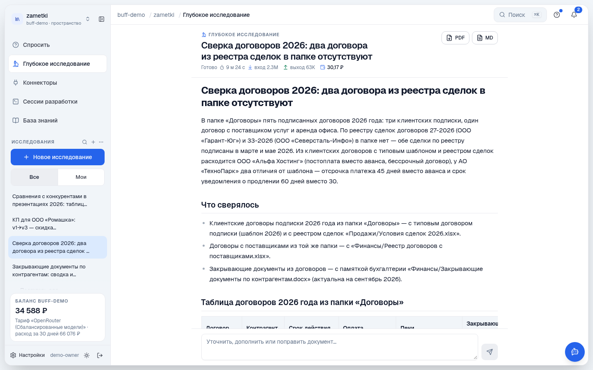
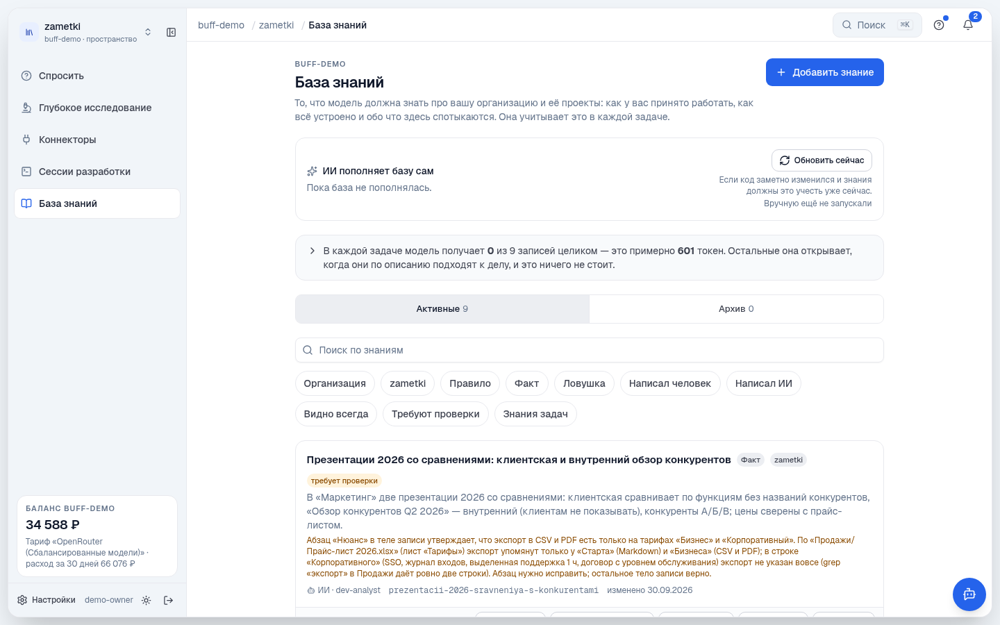
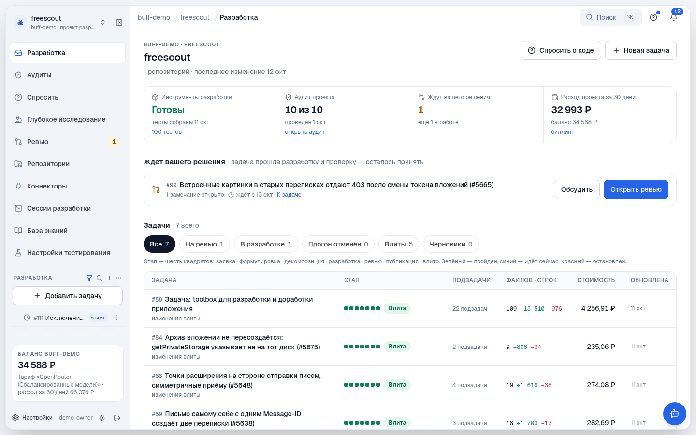

<p align="center">
  <picture>
    <source media="(prefers-color-scheme: dark)" srcset="assets/logo-dark.svg">
    
  </picture>
</p>

<p align="center">
  <b>ИИ-разработчик, аналитик и база знаний для вашей компании — на вашей машине, с вашей моделью.</b><br>
  Community Edition: бесплатно для внутреннего использования одной организацией.
</p>

<p align="center">
  <a href="https://github.com/buffsystems/buff-community/releases"></a>
  <a href="https://github.com/buffsystems/buff-community/pkgs/container/buff-community"></a>
  <a href="LICENSE.md"></a>
  <a href="https://buff.systems/docs/self-hosted/community"></a>
</p>

<p align="center">
  <a href="#установка-за-пять-минут">Установка</a> ·
  <a href="docs/install.md">Подробный гайд</a> ·
  <a href="#как-это-работает">Как это работает</a> ·
  <a href="#видео">Видео</a> ·
  <a href="https://buff.systems/docs/self-hosted/community">Документация</a> ·
  <a href="README.en.md">English</a>
</p>

---

**Buff** превращает задачу в трекере в готовую ветку с тестами, отвечает на вопросы по документам компании и пишет глубокие исследования — силами ИИ-агентов, которые работают автономно, но под контролем человека. Community Edition ставится на вашу машину одной командой: код, задачи и документы не покидают её, модель — ваша (любой OpenAI-совместимый эндпоинт).

**Разработка по задачам** — 4:36, со звуком. Нажмите play:

https://github.com/user-attachments/assets/32c45255-1b63-4d89-8dc4-956e112542cc

## Что умеет

| | |
|---|---|
| **Разработка по задачам** | Подключите репозиторий (GitHub, GitLab, Gitea, Bitbucket), опишите задачу — аналитик уточнит, разработчик реализует в изолированной песочнице, ревьюер проверит, тесты прогонятся. На выходе ветка и merge request. Вы утверждаете формулировку и результат. |
| **«Спросить»** | Вопрос по документам, регламентам и коду — ответ с опорой на источники и ссылками. Только чтение, без изменений. Для любого отдела, не только для инженеров. |
| **Глубокое исследование** | Два агента — аналитик и ревьюер — прорабатывают вопрос по вашим источникам и готовят выверенный документ: Markdown и PDF. |
| **База знаний** | То, что команда выяснила, остаётся в организации: записи с источниками, которыми пользуются и люди, и агенты. |
| **Buff Code** | Терминал для инженеров: та же организация, её модели и база знаний — из командной строки. Сессии видны в кабинете. |
| **Коннектор** | Встроенный коннектор к вашим git-провайдерам и источникам знаний (Notion, Confluence, Google Docs и др.) — токены остаются на вашей машине. |

<p align="center">
  
  
</p>

## Установка за пять минут

Нужны: Linux (Ubuntu 22.04/24.04, пользователь с `sudo`) или Docker Desktop на macOS/Windows; 4 CPU и 8 ГБ памяти; ключ к OpenAI-совместимому эндпоинту модели (OpenRouter, LiteLLM, vLLM, Ollama…). Подробные требования — в [гайде](docs/install.md#что-нужно).

```sh
git clone https://github.com/buffsystems/buff-community.git
cd buff-community
./install.sh
```

Скрипт спросит имя организации, почту администратора и адрес модели, поставит Docker (и Sysbox на Linux), скачает образ, соберёт песочницу агента и покажет ход первого старта прямо в терминале — до строки **готово**. Дальше:

- приложение — `http://<машина>:8138/app/`, логин `admin`, пароль — `ADMIN_PASSWORD` из `.env`;
- админка — `http://<машина>:8150`: пользователи, модель, воркеры, лицензия;
- лицензия — в админке «Лицензия» укажите организацию и почту: установка зарегистрируется на buff.systems и получит бессрочную лицензию Community (3 пользователя, 15 одновременных разработок, одна организация).

Обновление: `git pull && ./install.sh`. Снести: `docker compose down -v`. Остальное — в [подробном гайде](docs/install.md): настройка `.env`, коннектор к git-провайдерам, резервная копия, диагностика, Docker Desktop — со скриншотами.

## Как это работает

```
 браузер ──▶ frontend ──▶ middleware (NATS) ◀──long-poll── сервисы Buff ──▶ Gitea · Postgres · Windmill
                                                           │
                                            воркеры Windmill ──▶ песочницы агентов (внутренний docker)
                                                           │
                                            ваша модель (OpenAI-совместимый API) · ваши git-провайдеры
```

- **Один наш образ** `ghcr.io/buffsystems/buff-community` (~1,4 ГБ): все сервисы Buff под супервизором и внутренний docker для песочниц. На Linux — системный контейнер Sysbox, без `privileged`; на Docker Desktop — привилегированный.
- **Стоковые образы** PostgreSQL, Gitea (внутреннее git-хранилище), NATS, Windmill (оркестратор и его воркеры), Apache Tika — из их реестров, на условиях авторов.
- **Песочница агента** — образ `buff-community-sandbox`, который `install.sh` собирает на вашей машине поверх Windmill (все языковые рантаймы, как в SaaS). Каждый прогон идёт в своём контейнере во внутренней сети: наружу — только через посредника с ключом прогона, к модели и git — по вашим адресам.
- **Ничего не уходит наружу**, кроме запросов к вашей модели, ваших git-провайдеров и суточной проверки лицензии на buff.systems (четыре поля: идентификатор установки, версия, число пользователей и раннеров).

## Видео

Ещё три ролика со звуком (файлы mp4 — во [вложениях выпуска v0.21.1](https://github.com/buffsystems/buff-community/releases/tag/v0.21.1)):

**Buff за две минуты** — 1:23

https://github.com/user-attachments/assets/36d44fe2-071f-4b3c-86b0-2aad825b9b02

**Вопросы и база знаний** — 2:40

https://github.com/user-attachments/assets/d788e831-584d-4707-858d-f3956e9b24b1

**Buff Code** — 3:22

https://github.com/user-attachments/assets/481da974-11fa-495a-a660-3549f52888a2

<p align="center">
  
  
</p>

## Издания

| | Community | Enterprise on-premise | SaaS |
|---|---|---|---|
| Где работает | ваша машина | ваш контур | buff.systems |
| Организаций | одна | одна на лицензию | сколько нужно |
| Пользователей | до 3 | без ограничений | без ограничений |
| Задач в работе одновременно | до 15 | без ограничений | без ограничений |
| Единый вход, аудит, поддержка | — | да | да |
| Модель | ваша | ваша | наша или ваша |
| Цена | бесплатно | лицензия на организацию, помесячно | за токены |

Подробнее — [Издания](https://buff.systems/docs/self-hosted) и [тарифы](https://buff.systems/pricing).

## Участие и лицензия

Этот репозиторий — установочный комплект: `install.sh`, `docker-compose.yml`, настройки коннектора, документация. Правки комплекта, переводы и сообщения об ошибках — через [issues](https://github.com/buffsystems/buff-community/issues) и pull request, правила — в [CONTRIBUTING.md](CONTRIBUTING.md) (включая работу с ИИ-помощниками). Исходный код сервисов поставляется образом и не открыт.

Лицензия — [Buff Community Edition](LICENSE.md): внутреннее использование одной организацией, без перепродажи и услуг третьим лицам. Сторонние компоненты — [THIRD-PARTY.md](THIRD-PARTY.md).
