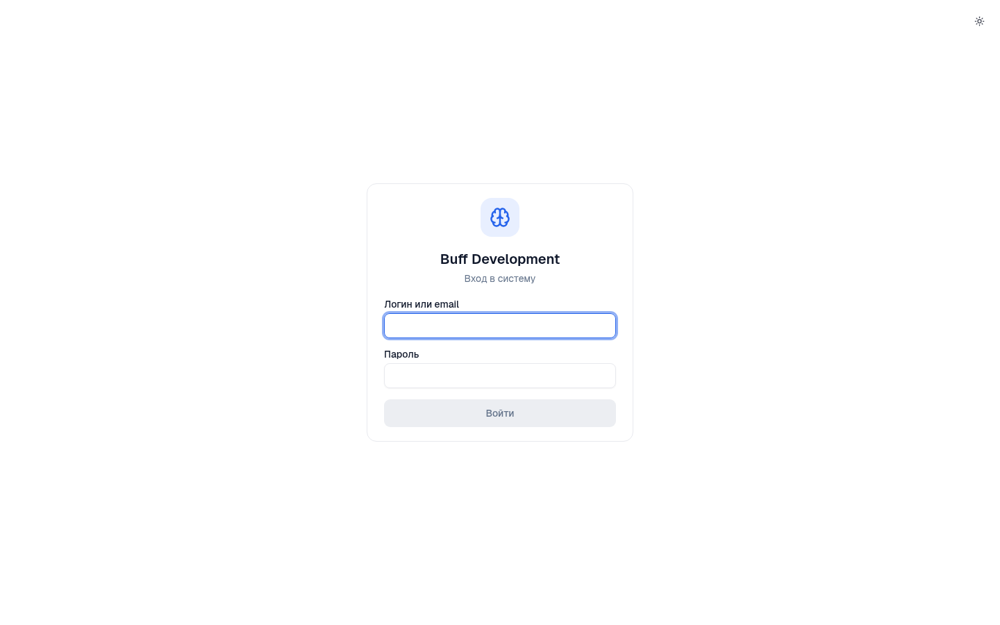
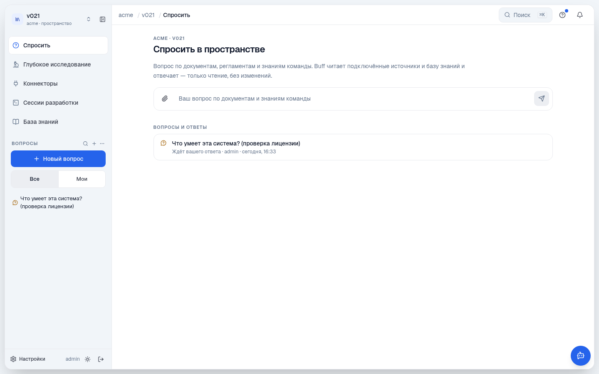
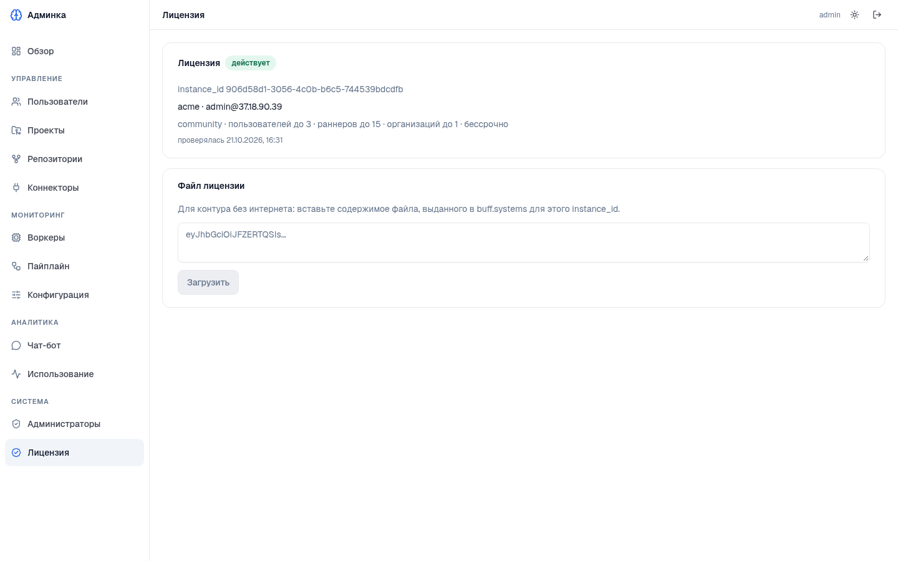
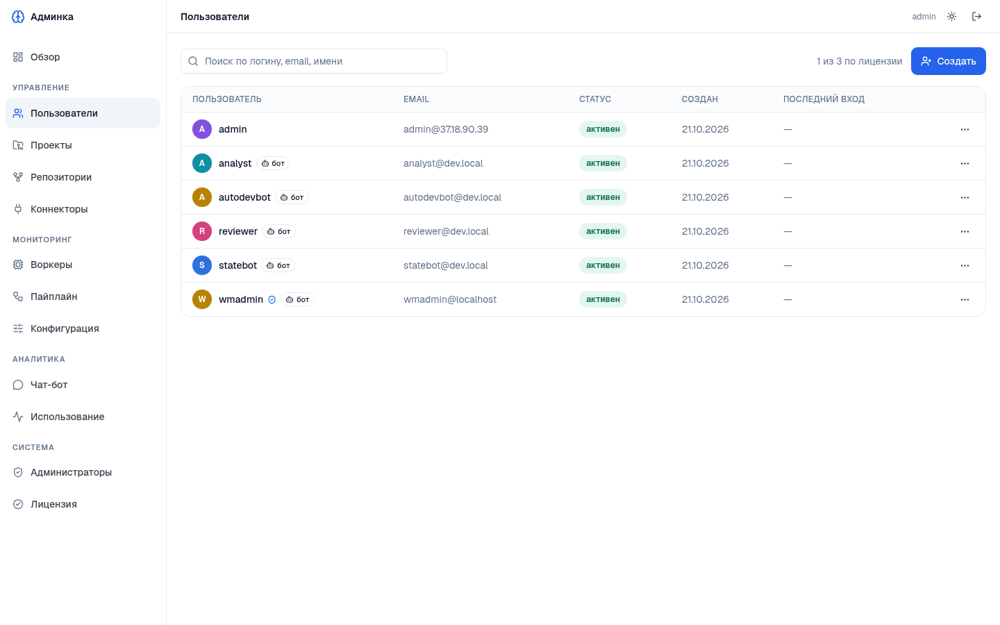
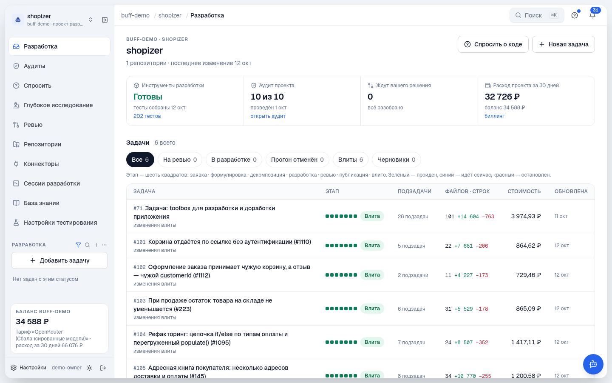
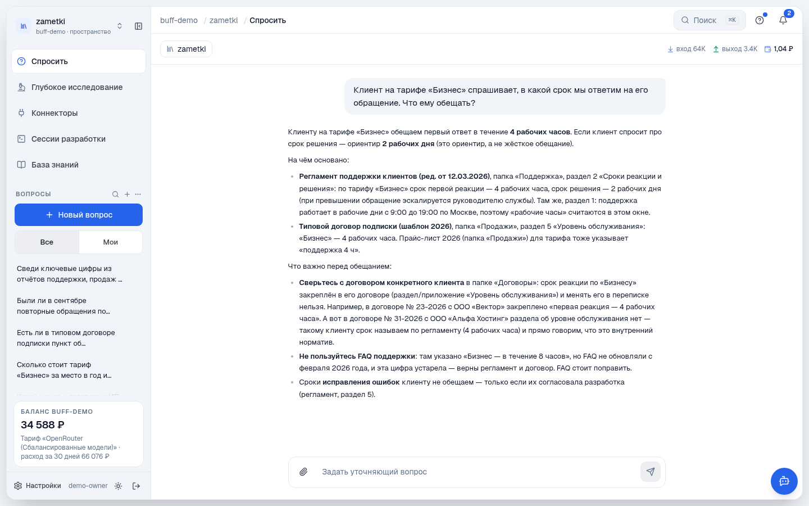

# Buff Community Edition: installation and setup

*[Русская версия](install.md)* · the same page on the site: [buff.systems/en/docs/self-hosted/community](https://buff.systems/en/docs/self-hosted/community)

A step-by-step guide from an empty machine to the first task. The short version is in the [README](../README.en.md). The product UI is in Russian; the screenshots show it as it is.

1. [Requirements](#requirements)
2. [One-command install](#one-command-install)
3. [Settings in `.env`](#settings-in-env)
4. [First login](#first-login)
5. [Licence](#licence)
6. [Users](#users)
7. [Repositories: the central connector](#repositories-the-central-connector)
8. [First work: a question, a research, a task](#first-work-a-question-a-research-a-task)
9. [Docker Desktop (macOS, Windows)](#docker-desktop-macos-windows)
10. [Air-gapped installs](#air-gapped-installs)
11. [Updating](#updating)
12. [Backups](#backups)
13. [Troubleshooting](#troubleshooting)
14. [What is inside](#what-is-inside)

## Requirements

| | Requirement |
|---|---|
| Linux | **Ubuntu 22.04 or 24.04**, amd64, kernel 5.7 or newer, a user with `sudo`, `git` installed. Runners work inside [Sysbox](https://github.com/nestybox/sysbox) — no privileged containers, no host socket |
| macOS, Windows | [Docker Desktop](https://docs.docker.com/desktop/); on Windows run the script from Git Bash. There is no Sysbox here, so **the Buff container runs privileged** — fine for a personal machine, not for a server |
| Resources | at least 4 CPU and 8 GB RAM (one development at a time); 8 CPU and 16 GB recommended for three concurrent ones — each takes up to 1.5 GB. About 12 GB of disk for images (stock ones, ours and the locally built sandbox) plus room for your repositories: data lives in Docker volumes, not in the image |
| Access | outbound internet: images from ghcr.io and Docker Hub, the daily licence check at buff.systems, your model endpoint |
| Model | a key to an OpenAI-compatible endpoint: [OpenRouter](https://openrouter.ai), your own LiteLLM, vLLM, Ollama, etc. |

> On Linux make sure the whole disk belongs to the root partition or is mounted under `/var/lib/docker` — a server image with an 8 GB root will not do. On Apple Silicon the image (amd64) runs under emulation and is noticeably slower.

## One-command install

Run it as a regular user with `sudo`; root is not needed:

```sh
git clone https://github.com/buffsystems/buff-community.git
cd buff-community
./install.sh
```

The script asks five questions (Enter keeps the default; everything can be changed later in `.env`):

```
настройки установки (Enter — оставить как есть, поправить можно потом в .env)
имя вашей организации латиницей [company]: acme            ← organisation name, latin letters
почта администратора [admin@37.18.90.39]: you@example.com  ← administrator e-mail
адрес OpenAI-совместимого эндпоинта модели [https://openrouter.ai/api/v1]:   ← model endpoint
ключ эндпоинта (ввод скрыт):                                ← endpoint key (hidden)
модель, например openai/gpt-4.1 []: openai/gpt-4.1          ← model
пароли записаны в …/buff-community/.env (пароль администратора — ADMIN_PASSWORD)
```

The same values can be passed as environment variables without the dialogue: `ORG=acme LLM_API_KEY=… ./install.sh`.

Then the script, on its own:

1. picks the mode — Linux (installs Docker and Sysbox) or Docker Desktop (adds `docker-compose.desktop.yml`);
2. creates `.env` from `.env.example` with random passwords;
3. pulls the edition image `ghcr.io/buffsystems/buff-community` and verifies it;
4. builds the agent sandbox image `buff-community-sandbox` on top of stock Windmill and hands it to the inner docker;
5. brings `docker compose` up and shows the first start right in the terminal — `[bootstrap]` lines until **готово** (ready); a few minutes: databases, accounts, pipeline deployment.

Re-running `./install.sh` on a working installation is safe: it only updates what changed.

## Settings in `.env`

`.env` sits next to `docker-compose.yml`, mode `600`. Worth checking:

| Variable | What it is |
|---|---|
| `ORG` | your organisation's name in latin letters, e.g. `acme` |
| `ADMIN_USER`, `ADMIN_EMAIL`, `ADMIN_PASSWORD` | the first application user, also the administrator; the password is generated and can be replaced |
| `LLM_BASE_URL`, `LLM_API_KEY`, `LLM_MODEL` | endpoint, key and model, e.g. `https://openrouter.ai/api/v1`, `sk-or-…`, `openai/gpt-4.1` |
| `APP_URL` | the address people open the application at; by default the machine's IP and port 8138 |
| `APP_PORT`, `ADMIN_PORT`, `BIND_IP` | application (8138) and admin (8150) ports and the interface they listen on |
| `RUNNERS` | how many development workers to run — that many developments run concurrently, 3 by default. Above the licence limit the value has no effect (Community: 15) |
| `BUFF_IMAGE`, `SANDBOX_IMAGE`, `WINDMILL_IMAGE` | image versions; change on update from `.env.example` |

Changed `.env` — apply it:

```sh
docker compose up -d
```

## First login

**The application** — `APP_URL` (`http://<host>:8138/app/`). Login `ADMIN_USER`, password `ADMIN_PASSWORD` from `.env`.



After logging in you are in your organisation, in its first space. The sections on the left: Ask («Спросить»), Deep research («Глубокое исследование»), Connectors («Коннекторы»), Development sessions («Сессии разработки»), Knowledge base («База знаний»). You can ask the first question as soon as the licence arrives (see below).



**The admin panel** — `http://<host>:8150`, user `admin`, the same password. Sections: users, projects, repositories, connectors, workers, pipeline, configuration, usage, licence.

## Licence

The installation runs under the Community licence: perpetual, with the [terms](../LICENSE.md) of internal use by one organisation. Without a licence **new tasks, runs, research and questions do not start**; login and reading work.

1. In the admin panel open Licence («Лицензия»), enter the organisation name and the administrator's e-mail, tick the personal-data consent and press Register («Зарегистрировать»).
2. The installation contacts buff.systems itself and receives the licence — usually within a minute, at most an hour. The status changes to «действует» (active).



The limits — users, concurrent developments, organisations — are signed into the licence and shown on the same page; installation settings above them have no effect. Once a day the installation checks the licence and sends four fields: installation id, version, the number of users and the number of runners. Losing the connection to buff.systems does not end the licence. For a network without internet there is the «Файл лицензии» (licence file) field — see [Air-gapped installs](#air-gapped-installs).

## Users

There is no self-registration: the administrator creates people in Admin → Users («Пользователи») → Create («Создать»). The counter on the right shows how many licence seats are taken. Accounts marked «бот» are the pipeline's service agents (analyst, developer, reviewer) and do not count. Every member sees everything in the organisation.



## Repositories: the central connector

In Community there is one connector and it is built into the installation: the **central connector** starts inside the container and pairs with your organisation on first start — it shows up in the application under Connectors within a minute or two. Its settings are the file `connector/connector.yaml` next to `docker-compose.yml`: it lists the git providers (GitLab, GitHub, Gitea, Bitbucket, self-hosted included) and their tokens; the format is described in the file's own comments. Tokens stay in that file on your machine.

Changed the file — restart the connector:

```sh
docker compose exec buff supervisorctl restart services:connector
```

Then connect a repository in the application: the project appears in the organisation with its tasks, audits and development settings.



The connector sees the network as the container does: it needs network access from this machine to your git server.

## First work: a question, a research, a task

- **Ask** — a question about the organisation's documents and code; an answer with sources, read-only. The quickest way to check that the model answers.
- **Deep research** — an analyst and a reviewer prepare a document (Markdown and PDF) from your sources; ten minutes to an hour depending on the model.
- **Task** — describe a task in a project: the analyst clarifies it with questions, after your approval the developer implements it in the sandbox, the reviewer checks, and the result is a branch and a merge request in your repository.



## Docker Desktop (macOS, Windows)

On macOS and Windows `install.sh` switches to Docker Desktop mode by itself (on Linux it can be forced: `BUFF_MODE=desktop ./install.sh`). In this mode the line `COMPOSE_FILE=docker-compose.yml:docker-compose.desktop.yml` is enabled in `.env`: Sysbox is unavailable, so the Buff container starts privileged with the `runc` runtime. This suits a personal machine and does not suit a server. On Windows run the script from Git Bash; Docker Desktop must be running beforehand.

## Air-gapped installs

If the machine has no internet access:

- put the edition image file and its `.sha256` into `images/` — `install.sh` loads it instead of pulling; the same for the sandbox: `images/buff-community-sandbox.tar.zst`;
- move the stock images (PostgreSQL, Gitea, NATS, Windmill, Tika) through your own registry or `docker save`/`docker load`;
- obtain the licence at buff.systems for the `instance_id` shown in the admin panel and paste it into the licence file field.

## Updating

```sh
git pull
./install.sh
```

Put the new `BUFF_IMAGE` and `SANDBOX_IMAGE` from the updated `.env.example` into `.env` — the script pulls the image, rebuilds the sandbox and restarts the containers. Database migrations apply on start. The installed version is shown in the admin panel.

## Backups

All data lives in Docker volumes: `pgdata` (databases), `gitea-data` (repositories), `buff-data` (secrets, keys, working directories), `buff-docker` (inner docker layers). To back up: stop the stack (`docker compose stop`), copy the volumes any usual way, start again. Keep `.env` with the copy — it holds the passwords.

## Troubleshooting

- `docker compose ps` — container state; `docker compose logs buff` — our container.
- `docker compose exec buff supervisorctl status` — services inside the container; `supervisorctl restart services:auth-worker` restarts one.
- Repeating the first start is safe: `docker compose exec buff buff-bootstrap` — every step is idempotent.
- Runners do not start — check that the sandbox image is in the inner docker: `docker compose exec buff /opt/docker-real/docker images`.
- Remove the installation entirely: `docker compose down -v` (data volumes are deleted) and `sudo rm -rf` of the kit directory — `connector/state` is written by the container as root.
- Questions and bugs go to the [repository's issues](https://github.com/buffsystems/buff-community/issues); how to file them is in [CONTRIBUTING.en.md](../CONTRIBUTING.en.md). Technical support is not provided for the Community Edition.

## What is inside

`docker compose` brings up stock images of PostgreSQL, Gitea (internal git storage, invisible to users), NATS, Windmill (server and workers — `RUNNERS` sets the number of workers) and Apache Tika next to one image of ours, `buff-community` (~1.4 GB), where all Buff services and an inner docker live under a supervisor. On Linux our image is a Sysbox system container with its own docker inside: agent sandboxes run there, without `privileged` and without the host socket; in Docker Desktop the same container runs privileged. Windmill workers start sandboxes through the socket of that inner docker on a shared volume.

The agent sandbox is a separate image, `buff-community-sandbox`: `install.sh` builds it on your machine on top of the same stock Windmill image (all language runtimes — parity with SaaS), adding docker, the Buff engine and the MCP servers, and hands it to the inner docker without a second download. Windmill is pulled from ghcr.io on its authors' terms and is part of none of our images; the other third-party components are in [THIRD-PARTY.md](../THIRD-PARTY.md).
